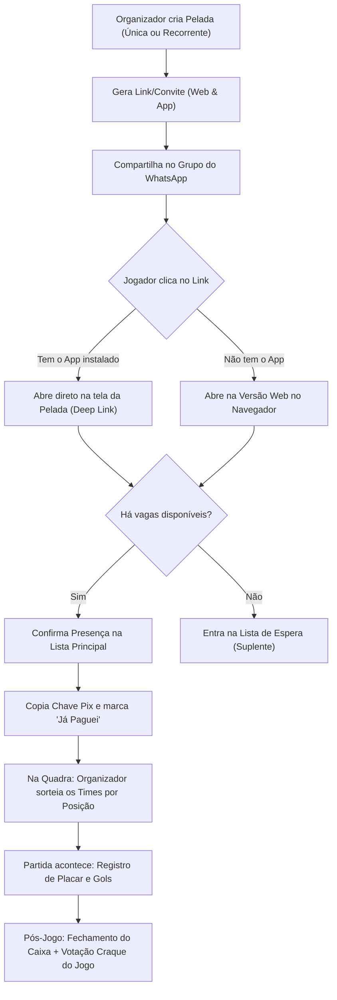

# ⚽ INFUT — Especificação de Produto, Funcionalidades, Rotinas e Permissões

> **Propósito do Documento:** Centralizar a visão de produto, regras de negócio, arquitetura de permissões, fluxos de rotina dos usuários e requisitos de lançamento do **INFUT** na **Google Play Store (Android)** e na **Web**.

---

## 1. Visão Geral do Produto

O **INFUT** é uma plataforma multiplataforma (Mobile e Web) para organização e gerenciamento de peladas e esportes em grupo (**Futebol, Futsal, Vôlei, Basquete, Handebol, Beach Tennis, Tênis de Mesa**, entre outros).

O objetivo central é eliminar a desorganização das listas manuais no WhatsApp, centralizando em um único ecossistema:
- Criação de eventos únicos ou recorrentes;
- Controle inteligente de confirmação de presença (com limite de vagas e lista de espera automática);
- Sorteio equilibrado de equipes por posição;
- Controle financeiro transparente (mensalistas, avulsos e pagamentos via Pix);
- Descoberta de jogos por região/mapa;
- Estatísticas, rankings e histórico esportivo dos jogadores.

### 🌐 Estratégia Multiplataforma (Play Store + Web)

| Plataforma | Papel Principal no Ecossistema | Diferenciais de Uso |
| :--- | :--- | :--- |
| **App Mobile (Google Play Store)** | Experiência principal de bolso para jogadores e organizadores na rotina diária e na beira da quadra. | Notificações Push em tempo real, GPS para peladas próximas, confirmação em 1 toque, cronômetro e placar ao vivo na quadra. |
| **Aplicação Web (Navegador)** | Porta de entrada sem fricção (via links compartilhados no WhatsApp) e painel gerencial completo. | Visualização de convite sem exigir instalação imediata, prévia rica (OpenGraph) no WhatsApp, gestão financeira detalhada em tela grande. |

---

## 2. Tipos de Acesso e Matriz de Permissões (RBAC)

O sistema adota controle de acesso baseado em papéis (**Role-Based Access Control**). Um mesmo usuário pode ser **Organizador** da sua pelada de quinta-feira e apenas **Jogador** na pelada de sábado de um amigo.

### 2.1. Perfis de Usuário

1. **Visitante (Não Autenticado / Link Web):**
   - Pessoa que clicou no link de convite enviado no grupo do WhatsApp.
   - Pode visualizar informações básicas da pelada pública/compartilhada (esporte, data, local, vagas restantes) antes de criar conta ou fazer login para confirmar presença.

2. **Jogador (Membro Padrão):**
   - Usuário cadastrado na plataforma.
   - Gerencia seu perfil de atleta (esporte favorito, posição em que joga, foto, região), busca peladas abertas, entra em grupos/eventos, confirma ou cancela presença, entra na lista de espera, informa pagamento e acompanha suas estatísticas.

3. **Co-organizador / Capitão (Moderador da Pelada):**
   - Jogador de confiança designado pelo Organizador para ajudar na operação do dia do jogo.
   - Pode confirmar presença de terceiros (check-in na quadra), realizar o sorteio dos times, controlar o placar/gols da partida e dar baixa em pagamentos recebidos.

4. **Organizador (Dono da Pelada):**
   - Criador e responsável geral pelo evento ou grupo recorrente.
   - Possui controle total sobre configurações da pelada, regras de vagas, valores financeiros, aprovação/remoção de membros, designação de co-organizadores e cancelamento do evento.

5. **Administrador da Plataforma (Super Admin - Backoffice):**
   - Equipe interna de gestão do INFUT.
   - Gerencia usuários globalmente, analisa denúncias de conduta, monitora métricas da plataforma e administra cadastros globais (modalidades, avisos do sistema).

---

### 2.2. Matriz de Permissões por Funcionalidade

| Ação / Funcionalidade | Visitante | Jogador | Co-organizador | Organizador | Super Admin |
| :--- | :---: | :---: | :---: | :---: | :---: |
| Visualizar página de convite da pelada (Web/App) | ✅ | ✅ | ✅ | ✅ | ✅ |
| Editar próprio perfil (nome, foto, esporte, posição, região) | ❌ | ✅ | ✅ | ✅ | ✅ |
| Buscar peladas públicas por região/mapa | ❌ | ✅ | ✅ | ✅ | ✅ |
| Confirmar / Cancelar a **própria** presença | ❌ | ✅ | ✅ | ✅ | ✅ |
| Entrar na Lista de Espera (quando lotado) | ❌ | ✅ | ✅ | ✅ | ✅ |
| Convidar amigos (compartilhar link/código) | ❌ | ✅* | ✅ | ✅ | ✅ |
| Informar pagamento / Copiar chave Pix da pelada | ❌ | ✅ | ✅ | ✅ | ✅ |
| Votar no "Craque do Jogo" / Avaliar partida | ❌ | ✅ | ✅ | ✅ | ✅ |
| Adicionar convidados avulsos manualmente na lista | ❌ | ❌ | ✅ | ✅ | ✅ |
| Confirmar / Remover presença de **outros** jogadores | ❌ | ❌ | ✅ | ✅ | ✅ |
| Realizar sorteio de times e ajustar equipes | ❌ | ❌ | ✅ | ✅ | ✅ |
| Registrar placar, gols e estatísticas da partida | ❌ | ❌ | ✅ | ✅ | ✅ |
| Dar baixa manual em pagamentos ("Marcar como Pago") | ❌ | ❌ | ✅ | ✅ | ✅ |
| Criar nova pelada (única ou recorrente) | ❌ | ✅ (vira Org.) | ✅ | ✅ | ✅ |
| Editar dados da pelada (local, horário, preço, vagas) | ❌ | ❌ | ❌ | ✅ | ✅ |
| Promover / Rebaixar Co-organizadores | ❌ | ❌ | ❌ | ✅ | ✅ |
| Excluir / Cancelar a pelada definitivamente | ❌ | ❌ | ❌ | ✅ | ✅ |
| Banir usuário da plataforma / Moderação global | ❌ | ❌ | ❌ | ❌ | ✅ |

*\*Jogadores podem compartilhar o link se a pelada estiver configurada pelo organizador como "Aberta a convites de membros".*

---

## 3. Funcionalidades Detalhadas do Aplicativo

### 3.1. Autenticação, Conta e Perfil de Atleta
* **Cadastro e Login Multiplataforma:**
  * Autenticação via E-mail e Senha (JWT) e preparado para Login Social (Google / Apple).
  * Recuperação de senha por e-mail.
* **Ficha Técnica do Jogador:**
  * Nome/Apelido, Foto de Perfil e Região/Bairro onde costuma jogar.
  * Seleção de Esporte Principal e **Posição Específica** (ex.: *Futebol:* Goleiro, Zagueiro, Lateral, Volante, Meia, Atacante; *Vôlei:* Levantador, Líbero, Ponteiro, Central, Oposto; *Futsal:* Fixo, Ala, Pivô, etc.).
* **Índice de Comprometimento (Assiduidade):**
  * Indicador visual de confiabilidade do atleta (evita os famosos "furões" que confirmam e faltam sem avisar).

### 3.2. Criação e Gestão de Peladas
* **Eventos Únicos ou Recorrentes:**
  * Criação de jogos avulsos ou **Recorrentes Semanais** (ex.: *Toda Quinta-feira às 20h*), gerando automaticamente as próximas ocorrências no calendário.
* **Configuração Completa do Evento:**
  * Título, Modalidade Esportiva, Data, Horário de Início e Duração em Horas (`durationHours`) com cálculo automático do horário de término.
  * Local (Nome da quadra/arena + Endereço completo com integração para abrir no Google Maps/Waze).
  * Link opcional do grupo no WhatsApp (`whatsappGroupUrl`), exibindo botão direto *"Entrar no Grupo do WhatsApp"* e inclusão automática no texto de convite.
  * Limite máximo de jogadores de linha e vagas reservadas para goleiros.
  * Visibilidade: **Privada** (acesso apenas via link/código de convite) ou **Pública** (visível no mapa/feed para jogadores da mesma região).

### 3.3. Confirmação de Presença (RSVP) e Lista de Espera Inteligente
* **Lista em Tempo Real:**
  * Divisão clara entre: **Confirmados (Dentro das vagas)**, **Goleiros**, **Lista de Espera (Suplentes)** e **Não vão (Baixas)**.
* **Promoção Automática da Fila de Espera:**
  * Quando a pelada atinge a lotação máxima (ex.: 14/14 jogadores), novos confirmados entram na Lista de Espera por ordem de chegada (1º suplente, 2º suplente...).
  * Se um jogador confirmado desistir dentro do prazo, o 1º da lista de espera é automaticamente promovido para a lista principal e recebe uma notificação imediata.
* **Horário Limite de Desistência (Deadline):**
  * O organizador pode definir uma trava (ex.: até 4 horas antes do jogo) para desistências sem penalidade na reputação ou cobrança de taxa.

### 3.4. Descoberta e Mapa de Peladas (Geolocalização)
* **Explorar Jogos na Região:**
  * Filtro por cidade/bairro, modalidade esportiva, dia da semana e faixa de preço.
  * Ideal para quem se mudou de cidade ou quer encontrar um grupo precisando de jogadores ("precisa-se de goleiro hoje às 20h").

### 3.5. Sorteio de Times e Operação de Jogo (Matchday)
* **Sorteio Inteligente de Equipes:**
  * Definição de quantos jogadores de linha por time (`playersPerTeam`, ex.: 5 na linha + 1 goleiro = máx. 6 atletas por equipe), respeitando estritamente o limite de vagas por equipe e listando atletas excedentes separadamente em **Próximo / De fora dos times**.
  * Escolha livre da **quantidade de times** (2 a 8) e dos **nomes ou cores** de cada equipe (ex.: *Time Amarelo*, *Time Azul*, *Time Vermelho*, *Com Colete*, *Sem Colete*).
  * Opção de **Sorteio Aleatório**, **Sorteio Equilibrado por Posição** (garantindo que dois zagueiros ou dois goleiros não caiam todos no mesmo time e distribuindo atacantes/meias igualmente) ou **Montagem Manual**.
  * Visualização clara das equipes formadas e histórico de partidas.
* **Placar, Cronômetro e Súmula Rápida:**
  * Cronômetro regressivo de partida com predefinições (7, 10 e 15 min) e alarme visual ao encerrar.
  * Registro rápido de placar, vitórias, gols e assistências por jogador durante a pelada ao vivo.

### 3.6. Controle Financeiro e Rateio (Caixa da Pelada)
* **Modalidades de Cobrança:**
  * Jogo Gratuito, Valor Fixo por Jogador (ex.: R$ 15,00 por pessoa) ou Rateio do Aluguel da Quadra.
  * Diferenciação entre **Mensalistas** e **Diaristas/Avulsos** (exclusiva para usuários com conta cadastrada — **convidados avulsos sem conta não podem ser definidos como mensalistas**), além de isenção configurável para Goleiros.
* **Integração Facilitada com Pix (Visível para Todos):**
  * O card **Chave Pix da Pelada** fica disponível na tela principal para todos os participantes copiarem a chave com 1 clique e informarem pagamento (*"Já Paguei via Pix"*).
* **Visibilidade Financeira e Caixa Exclusivo dos Organizadores:**
  * **Todos os participantes** podem visualizar o selo de status de pagamento (*Pago ✅*, *Em análise 🟡*, *Isento 🛡️*, *Pendente ⏳*) ao lado de cada jogador confirmado na lista de presença.
  * A aba **Financeiro (Caixa)** — com totais arrecadados, previstos e botões de baixa manual — é visível **exclusivamente para Organizadores e Co-organizadores**.

### 3.7. Estatísticas, Gamificação e Resenha Pós-Jogo
* **Votação de Destaques:**
  * Após o término do horário da pelada, abre-se a votação rápida entre os presentes para eleger o **Craque do Jogo (MVP)** e o **Goleiro Paredão**.
* **Ranking da Pelada e Perfil Histórico:**
  * Contabilização de Jogos Disputados, Vitórias, Gols Marcados e Prêmios de Craque da Partida.

---

## 4. Rotinas dos Usuários (Jornadas Passo a Passo)

Abaixo está o fluxo completo de como o aplicativo funciona no dia a dia de cada tipo de usuário:

---

### 4.1. Rotina do Organizador (Ciclo Semanal)

1. **Segunda-feira (Abertura da Lista):**
   - Se a pelada é recorrente, o INFUT já cria automaticamente o evento da semana seguinte.
   - O organizador toca em **"Compartilhar no WhatsApp"**; o app gera uma mensagem formatada com data, local, valor e o link direto (`infut.app/p/xyz`).
2. **Terça a Quinta-feira (Gestão Automática):**
   - O organizador **não precisa copiar e colar listas no WhatsApp**. Os próprios jogadores entram pelo app ou pela web e confirmam presença.
   - À medida que os jogadores pagam no Pix, o organizador recebe a notificação e dá um toque em *"Confirmar Pagamento"* na lista financeira.
3. **1 Hora Antes do Jogo (Preparação):**
   - O organizador confere a lista final fechada (ex.: 14 jogadores de linha + 2 goleiros).
   - Clica em **"Sortear Times"**, escolhe 2 ou 3 equipes equilibradas pelas posições cadastradas no perfil de cada jogador e publica a escalação no app.
4. **Durante e Após o Jogo (Quadra e Fechamento):**
   - Usa o cronômetro de 10 minutos por partida (ou delega para um Co-organizador anotar os gols).
   - Ao final, verifica na aba **Financeiro** quem ainda está pendente, cobra com 1 clique e encerra a pelada.

---

### 4.2. Rotina do Jogador (Membro Regular ou Convidado)

1. **Recebimento do Convite / Notificação:**
   - Recebe notificação push no celular (*"Lista aberta para a Peladinha da Quinta!"*) ou clica no link enviado no WhatsApp.
2. **Confirmação de Presença (RSVP):**
   - Visualiza quem já confirmou, o endereço da quadra, o valor e quantas vagas restam.
   - Clica em **"Confirmar Presença"** (informando se vai como jogador de linha ou goleiro).
3. **Pagamento sem Atrito:**
   - Na própria tela da pelada, clica em **"Copiar Chave Pix"**, realiza o pagamento no app do seu banco e marca **"Informar Pagamento"** no INFUT.
4. **Imprevisto / Desistência (Caso ocorra):**
   - Caso não possa mais ir, abre o app e clica em **"Cancelar Presença"**. O sistema libera a vaga instantaneamente para o próximo da fila sem precisar mandar mensagem no grupo.
5. **Na Hora do Jogo e Pós-Jogo:**
   - Abre o app para ver em qual time caiu no sorteio (ou clica no endereço para abrir a rota no Google Maps/Waze).
   - Após o jogo, vota no destaque da partida e vê suas estatísticas atualizadas no perfil.

---

### 4.3. Rotina do Jogador na Lista de Espera (Suplente)

1. O jogador tenta confirmar presença, mas a lista já está em `14/14`.
2. Ele clica em **"Entrar na Lista de Espera"** e fica como `1º Suplente`.
3. Quando um titular cancela a presença às 17h do dia do jogo, o suplente recebe um alerta imediato: *"Você subiu para a lista principal da Peladinha da Quinta!"*.

---

## 5. Arquitetura e Requisitos de Publicação (Play Store & Web)

Para garantir que o lançamento comercial ocorra sem bloqueios nas lojas e tenha alta adoção na Web, o projeto seguirá os seguintes pilares técnicos:

### 5.1. Requisitos da Google Play Store (Mobile Android)
* **Empacotamento via Expo EAS Build:** Geração do artefato assinado `.aab` (Android App Bundle) exigido pelo Google Play Console.
* **Exclusão de Conta In-App (Obrigatório pela Google Play):** Opção dentro de *Perfil > Configurações > Excluir minha conta e dados* para atender às diretrizes de privacidade de dados (LGPD e políticas da Google Play).
* **Política de Privacidade Pública:** Página hospedada na versão Web (`/privacidade` e `/termos`) vinculada na ficha da loja e na tela de cadastro.
* **Permissões Justificadas:** Solicitação limpa de permissões apenas no momento de uso (Câmera/Galeria para foto de perfil, Localização aproximada/precisa para mapa de peladas e Notificações Push).

### 5.2. Requisitos da Versão Web Publicada
* **Compatibilidade Multiplataforma (React Native Web / Expo Web ou Front-end Web Dedicado):**
  * Compartilhamento da mesma API REST (`backend/`) e regras de negócio.
* **Links Inteligentes e Prévia no WhatsApp (OpenGraph / Meta Tags):**
  * Ao colar o link de uma pelada no WhatsApp, deve aparecer automaticamente o título da pelada, data, local e número de vagas restantes.
* **Layout Responsivo Completo (Mobile, Tablet e Desktop Web):**
  * **Mobile (320px+):** Barra de navegação inferior, colunas empilhadas e quebra automática (`flexWrap`) em barras de ação e listas para evitar cortes em telas compactas.
  * **Tablet (768px+):** Containers ampliados (`820px`) com melhor aproveitamento de largura.
  * **Desktop Web (960px+):** Navegação convertida automaticamente em **Sidebar lateral esquerda**, grids de **2 colunas** nas listas (*Peladas*, *Explorar*, *Ranking*) e painéis divididos em 2 colunas nas telas de detalhes, jogo ao vivo, pós-jogo, gestão de membros e formulários (`1120px`).

### 5.3. Infraestrutura de Produção (Backend & Banco de Dados)
* **Banco de Dados em Produção:** Migração do SQLite local de desenvolvimento para **PostgreSQL** gerenciado em nuvem (ex.: Supabase, Neon ou Railway) utilizando o **Prisma ORM**.
* **Hospedagem da API:** Deploy automatizado em container/cloud com HTTPS configurado e CORS habilitado para o domínio Web e aplicativo Mobile.

---

## 6. Roadmap de Desenvolvimento até o Lançamento

| Fase | Foco Principal | Entregáveis Chave | Status |
| :--- | :--- | :--- | :---: |
| **Fase 1: Fundação** | Autenticação, Perfil e Cadastro de Peladas | Login/Registro JWT, Edição de Perfil Esportivo, Criação de Pelada (com recorrência) e Feed básico. | ✅ Concluído |
| **Fase 2: Core do MVP** | Presença, Detalhes e Convites | Tabela de Participantes, Tela de Detalhes da Pelada, Botão Confirmar/Sair, Lista de Espera, Edição de Pelada e Convite de Visitante. | ✅ Concluído |
| **Fase 3: Dia de Jogo & Caixa** | Sorteio de Times e Controle Financeiro | Sorteio equilibrado por posição, Placar ao vivo, Check-in na quadra, Controle de Pagamentos (Pix / Mensalista / Diarista) e Co-organizador. | ✅ Concluído |
| **Fase 4: Engajamento & Responsividade** | Estatísticas, Avaliações, Busca e Layout Multi-tela | Explorar por região/esporte, rota no Google Maps, registro de gols/vitórias, votação de Craque/Goleiro Paredão, Ranking geral e responsividade completa (Mobile 320px+ & Desktop Web com Sidebar/2 colunas). | ✅ Concluído |
| **Fase 5: Lançamento (Go-Live)** | Publicação Web e Google Play Store | Build Web em produção, PostgreSQL em nuvem, Termos/LGPD/Exclusão de Conta (prontos no app) e submissão na Google Play Store. | 🔄 Próximo Passo |

